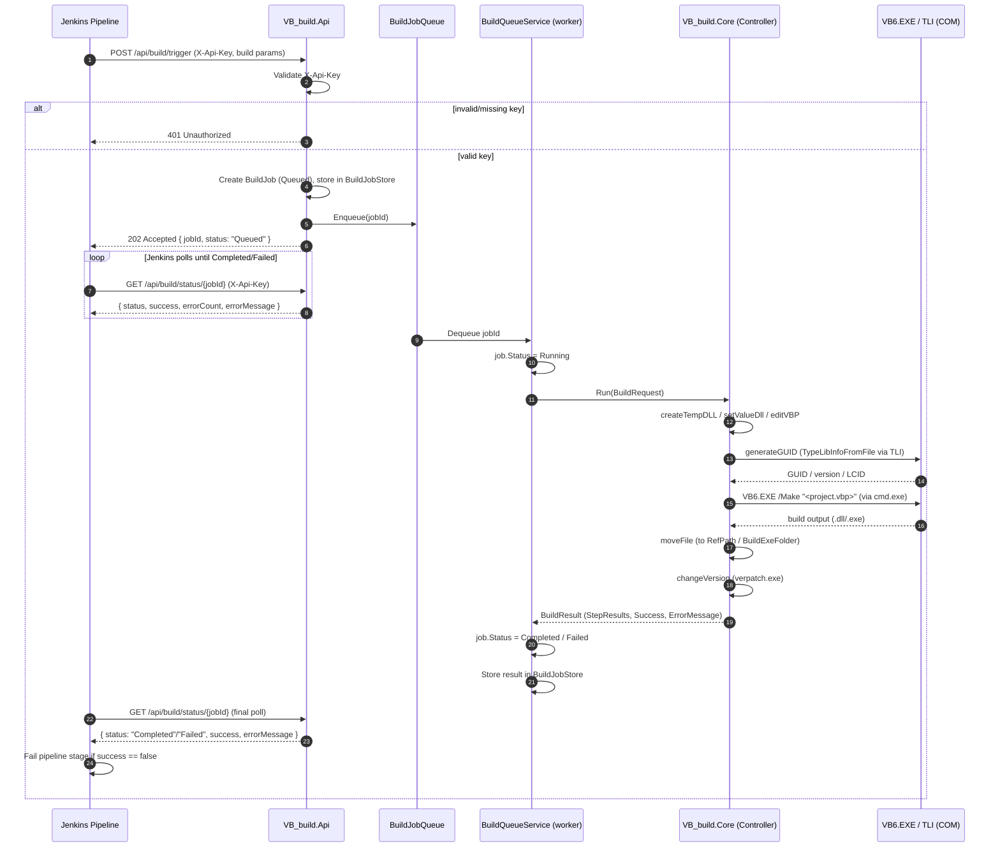

# VB6AutoBuildApp

Automates building VB6 (`.vbp`) DLL/EXE projects via `VB6.EXE`, with a Jenkins-friendly
Web API trigger.

## Projects

| Project | Type | Purpose |
|---|---|---|
| `VB_build.Core` | class library | Build logic (moved from the original `Controller.cs`). Edits the `.vbp` file, invokes `VB6.EXE /Make`, patches version info with `verpatch.exe`, moves output. Uses late-bound COM automation against `TLI` ("Visual Basic 6.0 IDE") to read DLL type-library GUID/version info. |
| `VB_build.Console` | console app | Same CLI as before: `VB_build.exe [-D|-E] <build_path> <ref_path> <version> <-b|-n> <time> [extra vb6 args...]`. |
| `VB_build.Api` | ASP.NET Core Web API | New HTTP trigger for Jenkins (see below). |
| `VB_build.Core.Tests` | xUnit | Unit tests for `BuildOptions`/`Controller` construction/`BuildResult` (no VB6 required). |
| `VB_build.Api.Tests` | xUnit + `WebApplicationFactory` | Integration tests for the trigger/status endpoints and API key auth, using a fake build runner (no VB6 required). |

All projects target **`net10.0-windows` / `x86`**. `x86` is required because `VB6.EXE` and the
`TLI` COM automation component are 32-bit only.

## Sequence diagram — Jenkins trigger → VB6 build



## Prerequisites on the actual build machine

- Windows, with VB6 (VB98) and the `TLI` automation component installed/registered.
- `verpatch.exe` available at the configured path.
- .NET 10 SDK (or just the ASP.NET Core / .NET runtime for running the published API).
- The API process (Kestrel or IIS app pool) must run in-process as **x86**.

> Note: `dotnet build`/`dotnet test` for all 5 projects above succeed on any machine
> (including this dev/CI sandbox) without VB6 installed, because the `TLI` COM API is
> called via late-bound `dynamic`/`Type.GetTypeFromProgID` instead of a design-time
> `<COMReference>`. Actually **running** a build (via the console app or a real
> `/api/build/trigger` call) still requires VB6 + `TLI` registered on that machine at
> runtime — that part can only be verified on a real build machine.

## Configuring paths

Hardcoded paths from the original app (`D:\log...`, `D:\verpatch.exe`, `C:\BuildExe`,
`C:\tempFile_vbauto\`, VB6.EXE / craxdui.dll locations) are now configurable via
`BuildOptions` (see `VB_build.Core/BuildOptions.cs`), while defaulting to the exact same
values as before:

- **Console app**: optional `appsettings.json` next to `VB_build.exe`, JSON keys matching
  the `BuildOptions` property names.
- **Web API**: `appsettings.json` → `"BuildOptions": { ... }` section, or environment
  variables (e.g. `BuildOptions__VerpatchExePath`).

## Web API — Jenkins trigger

### Auth

Every `/api/build/*` request requires header `X-Api-Key: <key>` matching the configured
`ApiKey` (appsettings.json `"ApiKey"` or environment variable `ApiKey`). **Set a real
secret before deploying** — the default `appsettings.json` ships with an empty key, which
makes the API reject all requests with `500` until configured.

### Trigger a build (async)

```
POST /api/build/trigger
X-Api-Key: <key>
Content-Type: application/json

{
  "isDll": true,
  "buildPath": "D:\\path\\to\\vbp\\folder",
  "refPath": "D:\\path\\to\\ref\\dlls",
  "version": "1.2.3.4",
  "compat": "-b",
  "time": "1",
  "command": []
}
```

Returns `202 Accepted` immediately with a job id:

```json
{ "jobId": "…", "status": "Queued", "success": null, "errorCount": null, "errorMessage": null, "createdAt": "…", "completedAt": null }
```

Builds run **one at a time** (a single background worker), because VB6/COM automation is
not safe to run concurrently.

### Poll for status

```
GET /api/build/status/{jobId}
X-Api-Key: <key>
```

`status` is one of `Queued`, `Running`, `Completed`, `Failed`. Have the Jenkins pipeline
poll this endpoint until `status` is `Completed` or `Failed`, then branch on `success`.

### Example Jenkins pipeline step

```groovy
def trigger = httpRequest url: "$API_URL/api/build/trigger",
    httpMode: 'POST', contentType: 'APPLICATION_JSON',
    customHeaders: [[name: 'X-Api-Key', value: env.VB6_API_KEY]],
    requestBody: groovy.json.JsonOutput.toJson([isDll: true, buildPath: '...', refPath: '...', version: '...', compat: '-b', time: '1', command: []])
def jobId = readJSON(text: trigger.content).jobId

timeout(time: 20, unit: 'MINUTES') {
    waitUntil {
        def status = httpRequest url: "$API_URL/api/build/status/${jobId}",
            customHeaders: [[name: 'X-Api-Key', value: env.VB6_API_KEY]]
        def body = readJSON(text: status.content)
        return body.status in ['Completed', 'Failed']
    }
}
```

## Deployment / Setup steps (Jenkins build machine)

### 1. Prepare the build machine
- Windows host with **VB6 (VB98)** installed and `TLI` (VB6 IDE automation) registered.
- Install the **.NET 10 Runtime** (ASP.NET Core Runtime, x86 is enough to host the API).
- Place `verpatch.exe` at the path configured in `BuildOptions` (default `D:\verpatch.exe`).
- Confirm the configured VB6.EXE / `craxdui.dll` paths match this machine's actual install locations.

### 2. Publish the API
```powershell
dotnet publish VB_build.Api\VB_build.Api.csproj -c Release -r win-x86 --self-contained false -o C:\deploy\VB_build.Api
```
`win-x86` / `PlatformTarget=x86` is required — VB6.EXE and `TLI` are 32-bit only.

### 3. Configure `appsettings.json` / `appsettings.Production.json`
- Set `"ApiKey"` to a real secret (never reuse the `dev-only-local-testing-key` from
  `appsettings.Development.json`).
- Update `"BuildOptions"` to this machine's real paths (`TempDllFolder`, `BuildExeFolder`,
  `LogFolder`, `VerpatchExePath`, `Vb6ExePathOn32BitOs`/`Vb6ExePathOn64BitOs`,
  `CraxduiPathOn32BitOs`/`CraxduiPathOn64BitOs`).
- Alternatively, set these via environment variables instead of editing the JSON, e.g.
  `ApiKey=xxxx`, `BuildOptions__VerpatchExePath=...`.

### 4. Host the API
Pick one:
- **Run directly**: `dotnet C:\deploy\VB_build.Api\VB_build.Api.dll --urls http://0.0.0.0:5000`
- **Windows Service**: wrap the published exe/dll with `sc.exe create` or [NSSM](https://nssm.cc/)
  so it starts automatically on boot.
- **IIS**: set the Application Pool to **Enable 32-Bit Applications = True** (required for
  VB6/COM), and point the site at the publish folder.

Smoke-test it's up (should return `404`, not a connection error, once `ApiKey` is set):
```powershell
curl http://localhost:5000/api/build/status/test -H "X-Api-Key: <your-key>"
```

### 5. Configure Jenkins
- Store the API key as a Jenkins credential (secret text), e.g. `VB6_API_KEY`.
- In the pipeline: `POST /api/build/trigger` with `X-Api-Key` header → capture `jobId` →
  poll `GET /api/build/status/{jobId}` until `status` is `Completed`/`Failed` → fail the
  stage if `success` is `false` (surface `errorMessage`). See the example Groovy snippet
  above.

### 6. Real end-to-end verification
- Trigger a build against a real `.vbp` project on the build machine and confirm the
  output file lands in `refPath` (DLL) or `BuildExeFolder` (EXE) as expected. This step
  requires an actual VB6 install and has not been exercised in this sandbox.

## Testing

```
dotnet build VB_autoBuildApp.sln
dotnet test VB_autoBuildApp.sln
```

Full functional verification of an actual `.vbp` build (real `VB6.EXE`/`TLI`) must be done
on a machine with VB6 installed; it is out of scope for the automated test projects.
